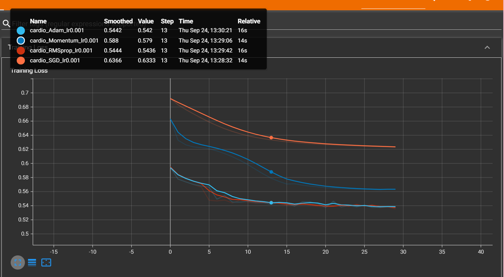

# TP2 — Régularisation, optimiseurs et métriques de classification

## 1. Dataset personnalisé

### StandardScaler et data leakage

Utiliser `StandardScaler()` avant de séparer les données est une mauvaise pratique, car la moyenne et l'écart-type sont calculés en utilisant aussi les données de validation et de test.  
Le modèle récupère donc indirectement des informations qu'il ne devrait pas connaître pendant l'entraînement : c'est du **data leakage**.

La bonne méthode est de faire le `fit()` du scaler uniquement sur le jeu d'entraînement, puis d'utiliser `transform()` sur les jeux de validation et de test.

### Dataset trop volumineux

Si le dataset est trop volumineux pour tenir en RAM, par exemple 500 Go, on peut utiliser :

```python
torch.utils.data.IterableDataset
```

Cette classe permet de charger les données progressivement, sous forme de flux, au lieu de tout charger en mémoire.

---

## 2. Régularisation L1 / L2

### Effet d'une forte régularisation L1

Avec :

```python
l1_lambda = 0.1
l2_lambda = 0
```

la loss passe de `6.6652` à `1.6340`, puis reste pratiquement bloquée à cette valeur jusqu'à la fin.

Avec une régularisation plus faible, la loss diminuait progressivement jusqu'à environ `0.7376`.

Une valeur de L1 trop élevée force beaucoup de poids du réseau à devenir très faibles ou proches de zéro. Le modèle devient alors trop simple et n'arrive plus à apprendre correctement. Ce phénomène est appelé **sous-apprentissage (underfitting)**, on l'appelle aussi l'effet de ping pong.

La précision n'a pas été enregistrée pendant cette expérience, mais une régularisation aussi forte tend également à limiter les performances du modèle.

### Régularisation L2 automatique dans PyTorch

Dans PyTorch, on peut appliquer la régularisation L2 directement avec l'argument :

```python
weight_decay
```

Exemple :

```python
optimizer = optim.SGD(
    model.parameters(),
    lr=0.01,
    weight_decay=1e-3
)
```

### Différence entre L1 et L2

- **L1** pousse certains poids vers zéro et favorise un modèle plus sparse.
- **L2** réduit surtout les poids trop grands, sans forcément les rendre exactement nuls.

---

## 3. Comparaison des optimiseurs

### Courbes TensorBoard

La figure suivante montre les courbes de perte obtenues avec les quatre optimiseurs :



### Quel optimiseur converge le plus rapidement au début ?

D'après nos résultats, **RMSprop et Adam convergent nettement plus vite que SGD et Momentum**.

À la première époque :

- SGD : `0.6959`
- Momentum : `0.6632`
- RMSprop : `0.5895`
- Adam : `0.5937`

RMSprop obtient donc la loss la plus faible dès le début, avec Adam très proche.

### SGD vs Momentum

Momentum converge plus rapidement que SGD simple.

Après 30 époques :

- SGD : `0.6252`
- Momentum : `0.5620`

L'ajout du momentum permet de conserver une partie de la direction des gradients précédents. Cela accélère la descente dans les directions utiles et réduit certaines oscillations.

---

## 4. Precision, Recall, F1 et AUC

### Définition de la Precision et du Recall

La **Precision** mesure, parmi les exemples prédits positifs, combien sont réellement positifs :

$$ Precision = \frac{TP}{TP + FP} $$

Le **Recall** mesure, parmi tous les exemples réellement positifs, combien ont été correctement détectés :

$$ Recall = \frac{TP}{TP + FN} $$

### Quelle métrique privilégier dans un contexte médical ?

Dans le contexte de la détection d'une maladie cardiovasculaire, il est généralement préférable de privilégier un **Recall élevé**.

Un faux négatif correspond à un patient réellement malade que le modèle considère comme sain. Cette erreur peut être plus grave qu'un faux positif, car le patient risque de ne pas être pris en charge ou examiné suffisamment tôt.

### Intérêt de l'AUC

La Precision, le Recall et le F1-score calculés ici dépendent d'un seuil fixé à `0.5`.

L'**AUC** mesure la capacité globale du modèle à distinguer les deux classes sur plusieurs seuils possibles. Elle donne donc une évaluation plus générale de la qualité de discrimination du modèle, sans dépendre uniquement du seuil `0.5`.
