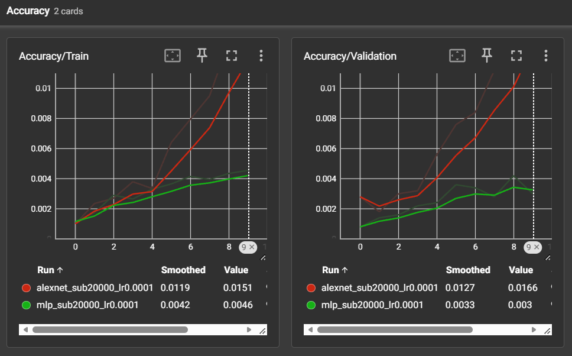
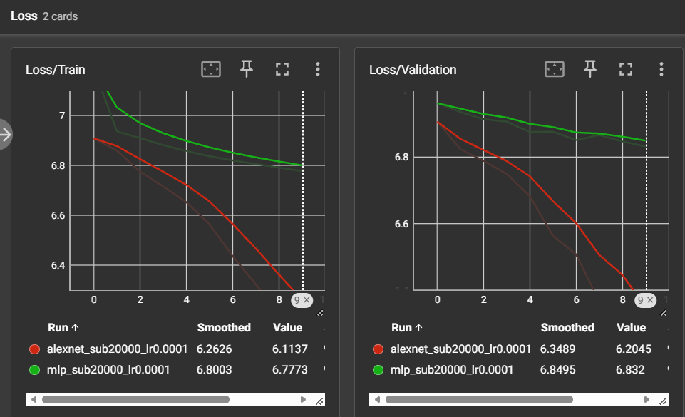
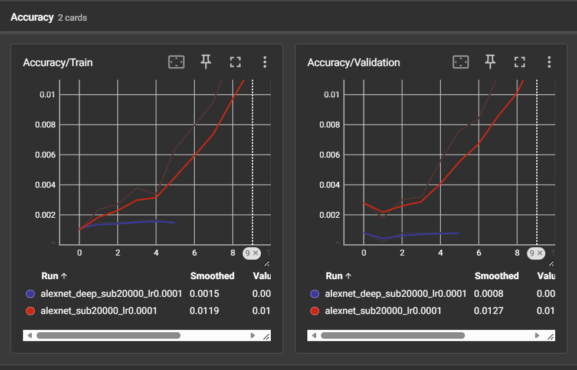
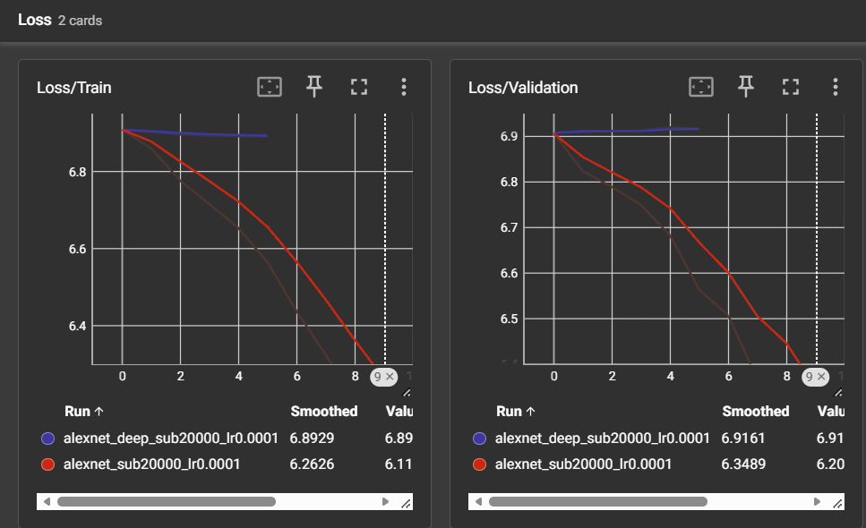
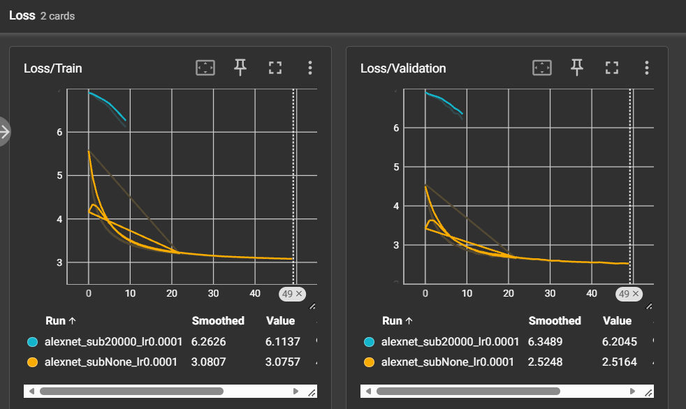
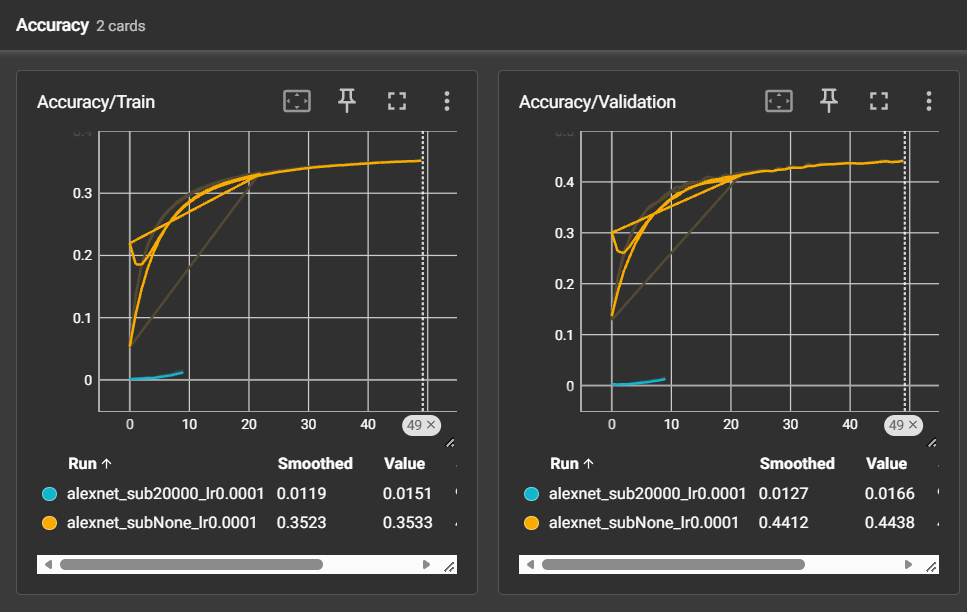

# TP3 — Réseaux convolutifs : MLP et AlexNet

## Exercice 1 — Préparation d’ImageNet et augmentation de données

### 1. Pourquoi normaliser les images ? Pourquoi utiliser uniquement les statistiques d’entraînement ?

Pour chaque canal, la normalisation est :

$$
x' = \frac{x-\mu}{\sigma}
$$

Sans `transforms.Normalize`, les canaux peuvent avoir des échelles différentes. La descente de gradient peut devenir moins stable et l’apprentissage plus lent. La normalisation améliore le conditionnement des données d’entrée.

Je calcule les statistiques uniquement sur le jeu d’entraînement. Utiliser le jeu de validation introduirait une **fuite de données** : j’exploiterais des informations réservées à l’évaluation.

### 2. Pourquoi utiliser des transformations différentes en entraînement et en validation ?

À l’entraînement, j’utilise `RandomResizedCrop(227)` et `RandomHorizontalFlip()`. Ces transformations créent des images variées. Elles améliorent la généralisation et limitent le sur-apprentissage.

En validation, j’utilise `Resize(256)` puis `CenterCrop(227)`, sans transformation aléatoire. Je peux ainsi comparer les époques avec une évaluation stable et reproductible.

### 3. Exemple où `RandomHorizontalFlip` fausse les étiquettes

Pour classer les panneaux « tourner à gauche » et « tourner à droite », un retournement horizontal inverse leur signification. Si je conserve l’étiquette d’origine, je produis une image mal étiquetée.

## Exercice 2 — Étude théorique et implémentation des architectures

### Question 2.a — Paramètres et limite structurelle du MLP

L’image contient :

$$
3 \times 227 \times 227 = 154\,587\text{ valeurs}
$$

Pour une couche linéaire :

$$
N_{\mathrm{sans\ biais}} = N_{\mathrm{entrée}} \times N_{\mathrm{sortie}},\qquad
N_{\mathrm{avec\ biais}} = N_{\mathrm{entrée}} \times N_{\mathrm{sortie}} + N_{\mathrm{sortie}}
$$

| Couche | Calcul sans biais | Sans biais | Avec biais |
|---|---|---:|---:|
| Linear1 : 154 587 → 256 | $154\,587\times256$ | 39 574 272 | 39 574 528 |
| Linear2 : 256 → 256 | $256\times256$ | 65 536 | 65 792 |
| Linear3 : 256 → 1 000 | $256\times1\,000$ | 256 000 | 257 000 |
| **Total** | | **39 895 808** | **39 897 320** |

La première couche contient **39 574 528 paramètres**, soit environ **99,19 %** du total.

Le défaut principal du MLP est l’aplatissement de l’image. Le réseau ne tient pas directement compte de la proximité des pixels. Il n’utilise pas non plus le partage des poids, contrairement aux convolutions.

### Question 2.b — Tableau détaillé d’AlexNet

Je calcule la dimension spatiale en sortie avec :

$$
H_{\mathrm{sortie}} = \left\lfloor\frac{H_{\mathrm{entrée}}+2P-K}{S}\right\rfloor+1
$$

Pour une couche de convolution avec biais :

$$
N_{\mathrm{paramètres}} = C_{\mathrm{sortie}}\big(C_{\mathrm{entrée}}K^2+1\big)
$$

Pour une sortie `float32` (4 octets par valeur) :

$$
M_{\mathrm{Ko}}=\frac{C\times H\times W\times4}{1024}
$$

| Couche | Taille d’entrée | Hyperparamètres | Taille de sortie | Paramètres avec biais | Mémoire sortie (Ko) |
|---|---|---|---|---:|---:|
| Conv1 + ReLU | 3 × 227 × 227 | 64 filtres, 11×11, S=4, P=2 | 64 × 56 × 56 | 23 296 | 784 |
| MaxPool1 | 64 × 56 × 56 | 3×3, S=2, P=0 | 64 × 27 × 27 | 0 | 182,25 |
| Conv2 + ReLU | 64 × 27 × 27 | 192 filtres, 5×5, S=1, P=2 | 192 × 27 × 27 | 307 392 | 546,75 |
| MaxPool2 | 192 × 27 × 27 | 3×3, S=2, P=0 | 192 × 13 × 13 | 0 | 126,75 |
| Conv3 + ReLU | 192 × 13 × 13 | 384 filtres, 3×3, S=1, P=1 | 384 × 13 × 13 | 663 936 | 253,50 |
| Conv4 + ReLU | 384 × 13 × 13 | 256 filtres, 3×3, S=1, P=1 | 256 × 13 × 13 | 884 992 | 169 |
| Conv5 + ReLU | 256 × 13 × 13 | 256 filtres, 3×3, S=1, P=1 | 256 × 13 × 13 | 590 080 | 169 |
| MaxPool3 | 256 × 13 × 13 | 3×3, S=2, P=0 | 256 × 6 × 6 | 0 | 36 |
| Flatten + Dropout | 256 × 6 × 6 | p=0,5 | 9 216 (1D) | 0 | 36 |
| Linear1 + ReLU + Dropout | 9 216 | 4 096 neurones, p=0,5 | 4 096 | 37 752 832 | 16 |
| Linear2 + ReLU | 4 096 | 4 096 neurones | 4 096 | 16 781 312 | 16 |
| Linear3 (sortie) | 4 096 | 1 000 classes | 1 000 | 4 097 000 | 3,91 |
| **Total** | | | | **61 100 840** | **≈ 2 339,16** |

**Où se trouvent les paramètres et la mémoire d’activations ?**

Les trois couches linéaires contiennent **58 631 144 paramètres**, soit environ **95,96 %** des poids d’AlexNet. Les premières couches convolutives produisent en revanche de grandes cartes de caractéristiques. Elles occupent l’essentiel de la mémoire des activations.

**Comparaison avec le MLP**

Pour les sorties des trois couches linéaires du MLP, je trouve :

$$
M_{\mathrm{MLP}} = \frac{(256+256+1000)\times4}{1024}=\boxed{5{,}91\ \mathrm{Ko/image}}
$$

Si j’ajoute l’entrée aplatie, le total atteint environ **609,76 Ko**. Cette entrée peut toutefois partager la mémoire de l’image initiale.

Le tableau d’AlexNet donne environ **2 339 Ko par image**, en additionnant toutes les sorties indiquées. AlexNet conserve de grandes cartes spatiales. Le MLP réduit immédiatement l’image à 256 neurones. J’explique ainsi la différence de mémoire malgré un nombre de paramètres du même ordre de grandeur.

*Cette somme suit la convention du tableau. Elle ne représente pas exactement la VRAM totale : `Flatten` peut partager sa mémoire et la rétropropagation demande d’autres tenseurs.*

### Question 2.c — Vérification des paramètres avec PyTorch

Je compare le résultat de `count_parameters()` aux calculs théoriques :

| Modèle | Paramètres théoriques avec biais |
|---|---:|
| MLP | 39 897 320 |
| AlexNet | 61 100 840 |

Le log de l’entraînement complet confirme **61 100 840 paramètres** pour AlexNet. Le comptage du MLP indiqué ici reste le résultat théorique à vérifier avec `--count-params` si je ne l’ai pas encore fait.

## Exercice 3 — Boucle d’entraînement et comparaison rapide

### Question 3.a — Rôle de `model.train()` et `model.eval()`

`model.train()` active le **Dropout**. Pendant l’entraînement, certains neurones sont désactivés aléatoirement. Cela limite leur dépendance mutuelle.

`model.eval()` désactive le Dropout pendant la validation. Si j’oublie cet appel, les prédictions de validation restent aléatoires en partie. Les mesures deviennent moins stables et moins représentatives de l’évaluation normale.

### Question 3.a — Accuracy et CrossEntropyLoss d’un choix aléatoire

Pour 1 000 classes équilibrées :

$$
\mathrm{Accuracy} = \frac{1}{1000}=0{,}001=\boxed{0{,}1\%}
$$

Si je prédis une distribution uniforme sur les 1 000 classes :

$$
\mathrm{CrossEntropyLoss}=-\ln(1/1000)=\boxed{\ln(1000)\approx6{,}9078}
$$

Au début des courbes, les pertes sont proches de **6,9** et les accuracies proches de **0,1 %**. Ce comportement est globalement cohérent avec une initialisation aléatoire.

### Question 3.a — Comparaison du MLP et d’AlexNet (20 000 images)

Je compare **uniquement le MLP et AlexNet standard** sur le même sous-ensemble.

*Figure 1 — Accuracy d’entraînement et de validation. La capture d’origine contient trois modèles ; je compare ici uniquement le MLP et AlexNet.*

*Figure 2 — Pertes d’entraînement et de validation. La capture d’origine contient trois modèles ; je compare ici uniquement le MLP et AlexNet.*

| Modèle | Train Loss | Val Loss | Train Accuracy | Val Accuracy |
|---|---:|---:|---:|---:|
| MLP | 6,8003 | 6,8495 | 0,42 % | 0,33 % |
| **AlexNet** | **6,2626** | **6,3489** | **1,19 %** | **1,27 %** |

*Je relève ici les dernières valeurs **lissées visibles** dans TensorBoard. Elles ne correspondent pas forcément à la même époque.*

**Quel modèle apprend le mieux ?**

**AlexNet apprend mieux que le MLP.** Sa perte de validation est plus faible (6,3489 contre 6,8495). Son accuracy de validation est plus élevée (1,27 % contre 0,33 %). Ses convolutions exploitent les motifs spatiaux des images, contrairement au MLP qui utilise les pixels aplatis.

**Quel modèle sur-apprend le plus vite ? Pourquoi ?**

Je ne vois **pas de sur-apprentissage net** sur ces premières époques. Les pertes de validation diminuent encore. L’écart entre Train Loss et Val Loss est plus grand pour AlexNet (environ 0,086) que pour le MLP (environ 0,049). AlexNet pourrait sur-apprendre plus facilement sur ce petit sous-ensemble grâce à sa capacité plus élevée, mais mes courbes ne montrent pas encore une hausse durable de la perte de validation.

### Question 3.b — Impact de la profondeur : AlexNet vs AlexNetDeep

J’ajoute trois convolutions **256 → 256**, de taille **3 × 3** et de padding **1**, chacune suivie d’une ReLU, après Conv5.

Chaque nouvelle convolution ajoute :

$$
256\times(256\times3\times3+1)=590\,080\text{ paramètres}
$$

AlexNetDeep contient donc :

$$
61\,100\,840+3\times590\,080=\boxed{62\,871\,080\text{ paramètres}}
$$

Je compare **uniquement AlexNet standard et AlexNetDeep**.

*Figure 3 — Accuracy d’entraînement et de validation. La capture d’origine contient trois modèles ; je compare ici uniquement AlexNet et AlexNetDeep.*

*Figure 4 — Pertes d’entraînement et de validation. La capture d’origine contient trois modèles ; je compare ici uniquement AlexNet et AlexNetDeep.*

| Modèle | Train Loss | Val Loss | Train Accuracy | Val Accuracy |
|---|---:|---:|---:|---:|
| **AlexNet** | **6,2626** | **6,3489** | **1,19 %** | **1,27 %** |
| AlexNetDeep | 6,8929 | 6,9161 | 0,15 % | 0,08 % |

*Ces valeurs sont lissées. AlexNetDeep et AlexNet n’ont pas nécessairement été observés au même numéro d’époque.*

**Est-ce un sur-apprentissage ou un sous-apprentissage ?**

**AlexNetDeep apprend moins bien qu’AlexNet standard.** Sa perte d’entraînement reste proche de 6,9. Son accuracy de validation est proche du hasard (0,1 %). Je constate donc plutôt un **sous-apprentissage ou une difficulté d’optimisation**, et non un sur-apprentissage. Le réseau profond ne parvient pas à bien apprendre, même sur les données d’entraînement.

**Comment l’expliquer avec le gradient ?**

Les trois couches ajoutées allongent la rétropropagation. Le gradient traverse davantage de transformations. Il peut s’atténuer avant d’atteindre les premières couches. Sans connexions résiduelles, l’apprentissage peut ainsi démarrer plus difficilement. Mes courbes sont compatibles avec cette difficulté, mais elles ne mesurent pas directement les gradients.

## Exercice 4 — Entraînement sur l’intégralité d’ImageNet

### 1. Profilage temporel et matériel

J’ai entraîné AlexNet sur l’intégralité d’ImageNet (`subset_size=None`) pendant **50 époques**. Le job Slurm **14228** s’est terminé avec l’état `COMPLETED` le 29 octobre 2026. Le réseau possède **61 100 840 paramètres** et chaque époque d’entraînement comporte **20 019 mini-batchs** (batch size 64).

| Élément | Résultat mesuré |
|---|---|
| GPU alloué au job 14228 | **1 NVIDIA H100 NVL** (`gres/gpu:nvidia_h100_nvl=1`) |
| Nœud de calcul | `arcadia-slurm-node-2` |
| Ressources allouées | **8 CPU et 16 Go de RAM** |
| Début du job | 28/10/2026 à 21:54:25 |
| Fin du job | 29/10/2026 à 08:59:33 |
| Durée totale du job | **11 h 05 min 08 s** (39 908 secondes) |
| Nombre d’époques terminées | **50** |
| Temps observé pour l’entraînement d’une époque | Environ **12 min 30 s à 12 min 49 s**, selon les logs `tqdm` (sans validation) |
| Durée moyenne estimée d’une époque complète | **13 min 18 s** (entraînement + validation + frais fixes répartis) |
| Temps estimé pour 100 époques sans Early Stopping | **22 h 10 min 16 s**, en extrapolant la durée totale du job |

Je calcule la durée moyenne d’une époque complète à partir du temps total mesuré par Slurm :

$$
T_{\mathrm{époque}} \approx \frac{39\,908}{50} = 798{,}16\ \mathrm{s} \approx 13\ \mathrm{min}\ 18\ \mathrm{s}.
$$

À cette vitesse, 100 époques demanderaient environ :

$$
T_{100} \approx 100 \times 798{,}16 = 79\,816\ \mathrm{s} \approx \boxed{22\ \mathrm{h}\ 10\ \mathrm{min}\ 16\ \mathrm{s}}.
$$

Cette moyenne inclut les coûts fixes du job, notamment le chargement initial, répartis sur 50 époques. Je l’utilise comme **estimation**, et non comme mesure exacte de chaque époque.

Le dossier TensorBoard contient **73 événements** pour un job de **50 époques**. Il semble regrouper plusieurs exécutions. Je n’utilise donc pas les 17,38 minutes calculées à partir de ces événements pour estimer le temps d’une époque.

Le GPU du job est confirmé par l’allocation Slurm. La **NVIDIA L4** observée auparavant correspondait à un **autre job** et ne doit pas figurer comme matériel d’entraînement du job 14228.

### 2. Analyse de l’entraînement sur le dataset complet

*Figure 5 — Évolution de Loss/Train et Loss/Validation. Le bleu correspond au sous-ensemble de 20 000 images, l’orange à ImageNet complet.*

*Figure 6 — Évolution d’Accuracy/Train et Accuracy/Validation, avec le run complet et le run de 20 000 images.*

Voici quelques mesures réelles du job 14228 :

| Époque | Train Loss | Val Loss | Train Accuracy | Val Accuracy |
|---|---:|---:|---:|---:|
| 1 | 5,5889 | 4,5563 | 5,23 % | 12,85 % |
| 5 | 3,8249 | 3,2425 | 23,67 % | 31,59 % |
| 10 | 3,4653 | 2,9000 | 29,11 % | 37,54 % |
| 20 | 3,2402 | 2,7366 | 32,61 % | 40,35 % |
| 30 | 3,1489 | 2,6101 | 34,14 % | 42,50 % |
| 40 | 3,1054 | 2,5598 | 34,85 % | 43,77 % |
| **50** | **3,0757** | **2,5164** | **35,33 %** | **44,38 %** |

*Les 50 lignes mesurées figurent dans `metriques_alexnet_full_50_epochs.csv`. Les chiffres de ce tableau viennent du log, et non des valeurs lissées de TensorBoard.*

**Comparaison avec les 20 000 images.** Sur le sous-ensemble, les dernières valeurs brutes visibles dans TensorBoard sont **6,1137** pour Train Loss, **6,2045** pour Val Loss, **1,51 %** d’accuracy d’entraînement et **1,66 %** d’accuracy de validation. Sur ImageNet complet, à l’époque 50, j’obtiens respectivement **3,0757**, **2,5164**, **35,33 %** et **44,38 %**. Les deux runs n’ont pas la même durée, mais la différence de performance est nette.

**Écart Train/Validation et sur-apprentissage.** Pour le petit sous-ensemble, l’écart final visible `Val Loss − Train Loss` est **+0,0908**. Pour le dataset complet, à l’époque 50, il est **−0,5593** (`2,5164 − 3,0757`). La perte de validation ne remonte pas de façon durable. Je ne constate donc pas de sur-apprentissage marqué dans le run complet.

La taille du dataset et la Data Augmentation exposent le modèle à davantage d’images variées. Cela limite la mémorisation d’exemples particuliers et favorise la généralisation. L’écart négatif est aussi influencé par le Dropout et par le fait que les transformations de validation sont différentes de celles de l’entraînement. Je ne peux donc pas attribuer tout cet écart uniquement à l’absence de sur-apprentissage.

### 3. Pourquoi `Loss/Validation` peut être inférieure à `Loss/Train` ?

**Première raison : le Dropout.** Avec `model.train()`, je désactive aléatoirement certains neurones pendant l’entraînement. Cela augmente la difficulté de la tâche et peut élever la perte d’entraînement. Avec `model.eval()`, le Dropout est désactivé pendant la validation.

**Deuxième raison : la Data Augmentation.** À l’entraînement, j’applique `RandomResizedCrop` et `RandomHorizontalFlip`. Certaines images deviennent plus difficiles à reconnaître. En validation, `Resize` et `CenterCrop` produisent des images déterministes, sans augmentation aléatoire.

Ces deux choix techniques expliquent qu’une perte de validation inférieure à la perte d’entraînement ne soit pas, à elle seule, anormale.
