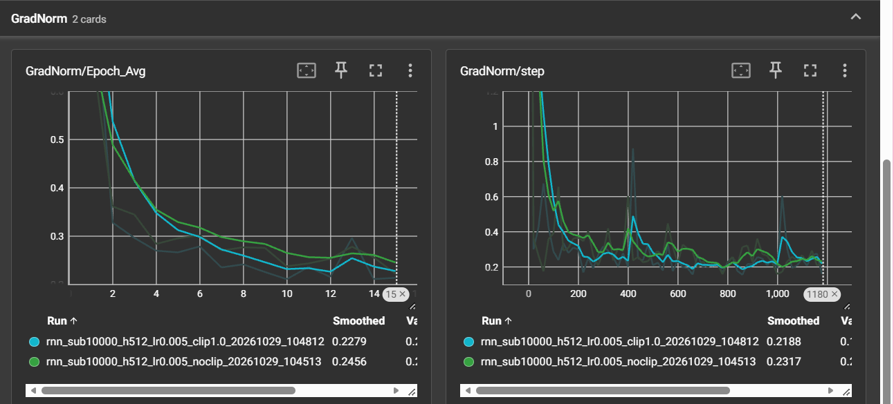
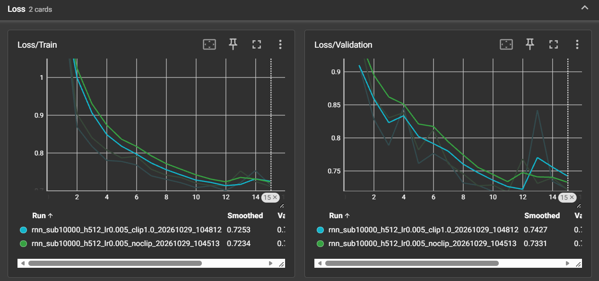
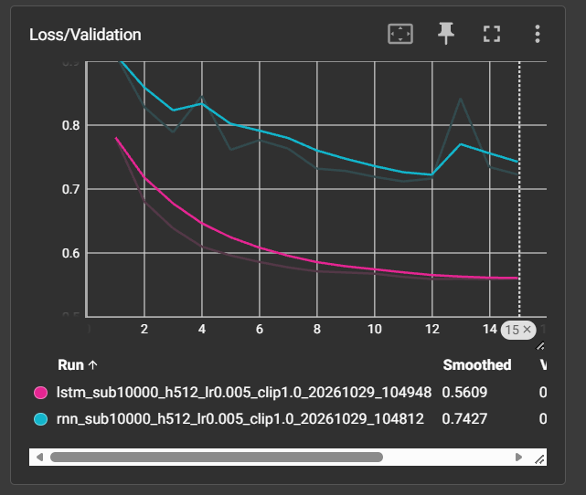
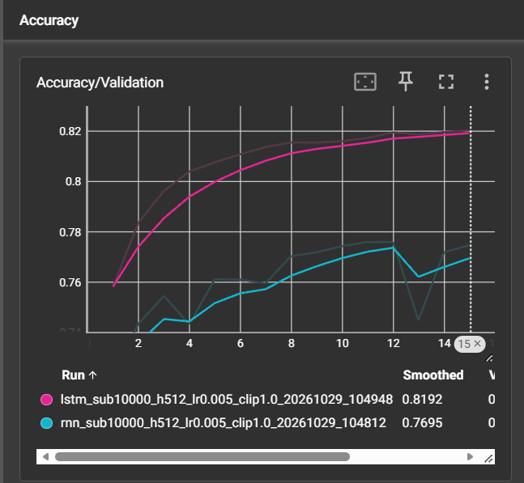
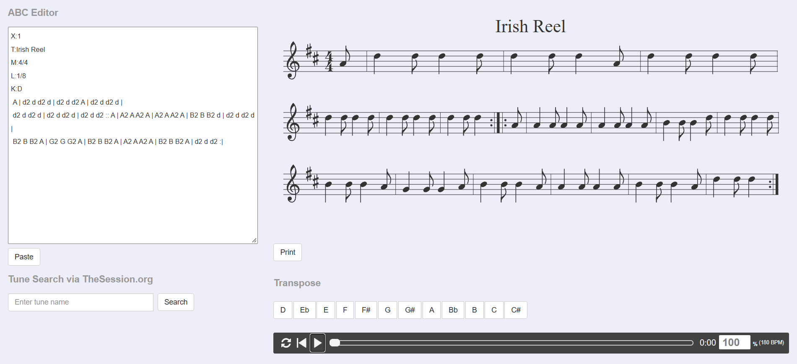
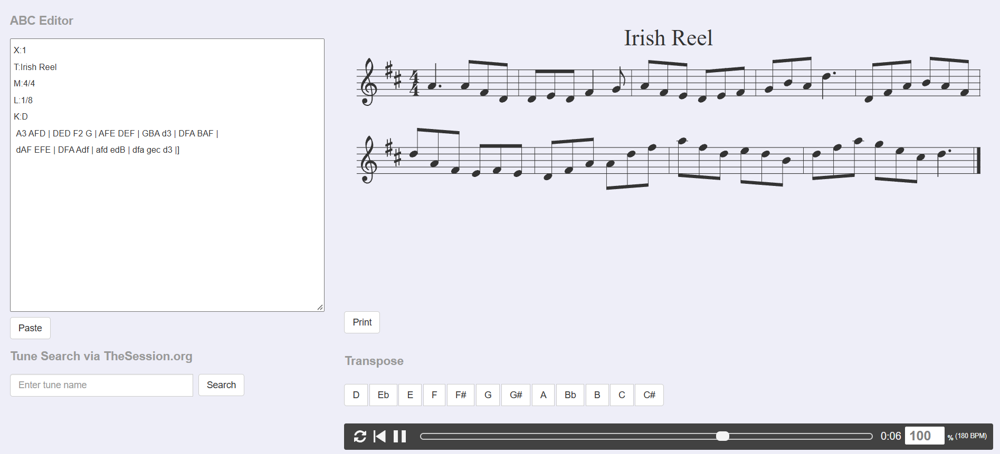
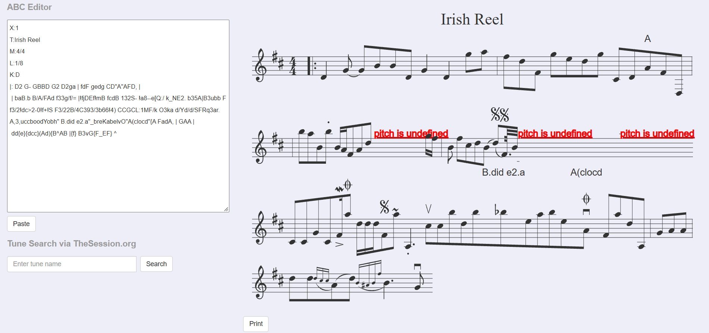

# TP4 — Réseaux récurrents et génération de séquences musicales

## Exercice 1 — Exploration et prétraitement des partitions ABC

### Question 1.a — Chargement et inspection des données

| Indicateur | Valeur mesurée |
|---|---:|
| Nombre de partitions dans `train.json` | 214 122 |
| Nombre de partitions dans `validation.json` | 2 162 |

J'ai inspecté la première partition du jeu d'entraînement. Son en-tête contient :

```abc
X:1
L:1/8
M:4/4
K:Emin
|: E2 EF E2 EF | DEFG AFDF | E2 EF E2 B2 |1 efe^d e2 e2 :|2 efe^d e3 B |: e2 ef g2 fe |
defg afdf |1 e2 ef g2 fe | efe^d e3 B :|2 g2 bg f2 af | efe^d e2 e2 ||
```

- `X:1` donne le numéro de référence de la partition.
- `L:1/8` fixe la durée par défaut à une croche.
- `M:4/4` indique une mesure à quatre temps.
- `K:Emin` indique la tonalité de mi mineur.

Cette partition ne contient pas de champ `T:` (titre). Les lettres désignent les notes, les chiffres leur durée, et les barres `|` séparent les mesures. Les symboles de reprise indiquent des passages à répéter.

### Question 1.b — Vocabulaire et padding

**1. Statistiques du jeu d'entraînement**

| Indicateur | Valeur mesurée |
|---|---:|
| Nombre de caractères uniques (`vocab_size`) | 95 |
| Longueur moyenne d'une partition | 290,11 caractères |
| Longueur maximale d'une partition | 2 968 caractères |

**2. Pourquoi utiliser `sorted()` ?**

J'utilise `sorted()` pour obtenir un ordre déterministe des caractères. Chaque caractère conserve ainsi le même indice quand je reconstruis le vocabulaire à partir des mêmes données. Sans ce tri, les indices peuvent changer entre l'entraînement et la génération. Le modèle sauvegardé risque alors de produire des caractères incorrects.

**3. Pourquoi choisir `SEQ_LENGTH = 500` ?**

Je fixe la longueur à 500 caractères pour limiter le padding, la mémoire GPU et le temps de calcul. Une longueur de 2 968 caractères imposerait de nombreux espaces inutiles aux partitions courtes. Elle allongerait fortement la rétropropagation et pourrait renforcer l'apprentissage du padding au lieu des notes. En contrepartie, les partitions longues sont tronquées.

---

## Exercice 2 — Dataset autorégressif et architecture RNN/LSTM

### Question 2.a — Forme des tenseurs et choix du type

Avec `SEQ_LENGTH = 500` et `BATCH_SIZE = 128`, j'obtiens :

```text
x.shape = (128, 499)
y.shape = (128, 499)
x.dtype = torch.int64
```

`x` contient les 499 premiers caractères de chaque séquence. `y` contient les 499 derniers, décalés d'une position, pour prédire le caractère suivant. J'utilise `torch.long` (`int64`) car `nn.Embedding` attend des indices entiers de caractères. Des flottants `float32` ne conviennent pas à cet indexage.

### Question 2.b — Paramètres et fonctionnement des modèles

**1. Calcul des paramètres (`vocab_size = 95`, `embedding_dim = 256`, `hidden_size = 512`)**

Pour l'embedding :

$$
P_{\mathrm{emb}} = 95 \times 256 = 24\,320
$$

Pour le RNN simple, PyTorch utilise une matrice entrée-caché, une matrice caché-caché et deux vecteurs de biais :

$$
P_{\mathrm{RNN}} = (512 \times 256) + (512 \times 512) + 2 \times 512 = 394\,240
$$

Pour le LSTM, les mêmes paramètres sont présents pour **quatre portes/blocs** :

$$
P_{\mathrm{LSTM}} = 4\left[(512 \times 256) + (512 \times 512) + 2 \times 512\right] = 1\,576\,960
$$

Pour la couche de sortie :

$$
P_{\mathrm{FC}} = 512 \times 95 + 95 = 48\,735
$$

| Bloc | RNN | LSTM |
|---|---:|---:|
| Embedding | 24 320 | 24 320 |
| Récurrent | 394 240 | 1 576 960 |
| Linear | 48 735 | 48 735 |
| **Total** | **467 295** | **1 650 015** |

J'ai vérifié ces totaux avec `count_parameters()`. Ils correspondent aux résultats PyTorch. Le bloc récurrent LSTM possède exactement quatre fois plus de paramètres que le bloc RNN car il calcule quatre transformations (portes d'entrée, d'oubli, de sortie et état candidat). Le réseau complet n'est pas quatre fois plus grand, car l'embedding et la couche linéaire sont identiques.

**2. Intérêt de `nn.Embedding`**

J'utilise `nn.Embedding` pour représenter chaque caractère par un vecteur appris. Un indice scalaire passé directement à une couche linéaire introduirait une relation artificielle entre les numéros des caractères. L'embedding apprend au contraire une représentation propre à chaque caractère.

**3. Structure de `hidden_state`**

Un `nn.RNN` retourne uniquement l'état caché `h_n`, qui résume les informations de la séquence. Un `nn.LSTM` retourne le couple `(h_n, c_n)`. `h_n` est l'état caché utilisé pour produire la sortie. `c_n` est l'état mémoire, qui peut conserver plus longtemps les informations utiles.

---

## Exercice 3 — Entraînement, gradients et comparaison RNN/LSTM

### Question 3.a — Manipulations et analyses

**1. Pourquoi `reshape(-1, vocab_size)` et `reshape(-1)` ?**

Les logits ont la forme `(batch_size, seq_len, vocab_size)` et les cibles `(batch_size, seq_len)`. Je les transforme en `(batch_size × seq_len, vocab_size)` et `(batch_size × seq_len)` pour que `CrossEntropyLoss` calcule une prédiction par caractère. Pour un batch complet de 128 séquences et 499 positions, la dimension `-1` déduite vaut :

$$
128 \times 499 = 63\,872
$$

**2. Pourquoi placer le clipping entre `backward()` et `step()` ?**

J'appelle `loss.backward()` pour calculer les gradients. J'applique ensuite `clip_grad_norm_` pour limiter leur norme avant la mise à jour. Enfin, `optimizer.step()` modifie les poids. Un clipping avant `backward()` ne pourrait pas agir sur les nouveaux gradients ; après `step()`, il arriverait trop tard.

**3. Analyse expérimentale des trois runs**

| Mesure | RNN sans clipping | RNN avec clipping | LSTM avec clipping |
|---|---:|---:|---:|
| Meilleure Validation Loss | 0,7176 | 0,7119 | **0,5588** |
| Époque correspondante | 11 | 11 | 14 |
| Accuracy à cette époque | 77,46 % | 77,59 % | **81,96 %** |
| Validation Loss à l'époque 15 | 0,7221 | 0,7227 | **0,5600** |
| Accuracy à l'époque 15 | 77,33 % | 77,47 % | **82,03 %** |

**Run 1 vs Run 2 : effet du Gradient Clipping**





Je constate que les deux RNN apprennent correctement. Le clipping améliore légèrement la meilleure perte de validation, de 0,7176 à 0,7119. Les normes des gradients diminuent au fil des époques. Les courbes montrent des pics au début et pendant l'entraînement, mais pas d'explosion persistante. Le clipping protège contre **l'explosion des gradients** : lorsqu'une norme est trop élevée, il réduit la taille des gradients avant la mise à jour des poids. Les normes affichées correspondent aux valeurs **avant clipping** ; une norme moyenne inférieure à 1 n'exclut pas des pics au-dessus de 1.

**Run 2 vs Run 3 : RNN avec clipping contre LSTM avec clipping**





Je constate que le LSTM converge plus vite et obtient une meilleure validation : perte minimale de 0,5588 contre 0,7119 pour le RNN, et accuracy de 81,96 % contre 77,59 % aux meilleures époques respectives.

Le LSTM contrôle l'actualisation de sa mémoire grâce à ses portes. Son état mémoire évolue selon :

$$
\begin{aligned}
c_t &= f_t \odot c_{t-1} + i_t \odot \tilde{c}_t \\
h_t &= o_t \odot \tanh(c_t)
\end{aligned}
$$

`f_t` sélectionne ce qui est conservé, `i_t` ce qui est ajouté, et `o_t` ce qui est exposé en sortie. Le terme additif dans `c_t` facilite le passage de l'information et du gradient sur de longues séquences. Le LSTM gère donc mieux les dépendances musicales longues qu'un RNN simple.

**4. Pourquoi l'accuracy de validation est-elle optimiste ?**

Une partition de 250 caractères complétée jusqu'à 500 contient environ 250 espaces de padding. Le modèle peut obtenir de nombreuses prédictions correctes en prédisant ces espaces, sans vraiment apprendre les notes. L'accuracy affichée surestime donc sa qualité musicale.

Je peux exclure les espaces de la perte avec :

```python
loss_fn = nn.CrossEntropyLoss(ignore_index=char_to_index[" "])
```

Cette solution ignore aussi les espaces réels des partitions. Une solution plus précise consiste à utiliser un masque de padding distinct et à calculer également l'accuracy sur les positions non paddées.

---

## Exercice 4 — Génération musicale, température et Slurm

### Question 4.a — Génération autorégressive

**1. Efficacité algorithmique**

Si je repasse toute la séquence générée au modèle à chaque nouveau caractère, je traite successivement 1, 2, ..., N caractères. Le coût total est proportionnel à :

$$
1+2+\cdots+N = \sum_{k=1}^{N} k = \frac{N(N+1)}{2} = O(N^2)
$$

En conservant `hidden_state`, je ne passe qu'un caractère à chaque itération. Le coût de génération devient **$O(N)$**, à architecture fixée, après la lecture initiale de l'amorce.

**2. Rôle de la température**

J'échantillonne le caractère suivant avec :

$$
P_T(c) = \frac{\exp(z_c/T)}{\sum_{j=1}^{V}\exp(z_j/T)}
$$

Quand $T \to 0^{+}$, la distribution se concentre sur le caractère au logit maximal : cela se rapproche d'un décodage **greedy**. Quand $T \to +\infty$, les probabilités deviennent presque uniformes : la génération est beaucoup plus aléatoire.

**3. Générations et analyse qualitative**

J'ai utilisé le meilleur checkpoint du LSTM entraîné à plus grande échelle, sauvegardé à l'époque 8, pour produire trois extraits avec la même amorce `X:1`, `T:Irish Reel`, `M:4/4`, `L:1/8`, `K:D`. Les espaces de fin sans information musicale ont été retirés ci-dessous pour faciliter la lecture.

**Température T = 0,2**

```abc
X:1
T:Irish Reel
M:4/4
L:1/8
K:D
 A | d2 d d2 d | d2 d d2 A | d2 d d2 d |
 d2 d d2 d | d2 d d2 d | d2 d d2 :: A | A2 A A2 A | A2 A A2 A | B2 B B2 d | d2 d d2 d |
 B2 B B2 A | G2 G G2 A | B2 B B2 A | A2 A A2 A | B2 B B2 A | d2 d d2 :|
```



La partition s'affiche dans ABC Player, mais la mélodie répète souvent les mêmes notes et les mêmes rythmes. Plusieurs mesures sont irrégulières par rapport au `M:4/4` annoncé. La diversité musicale est faible.

**Température T = 0,8**

```abc
X:1
T:Irish Reel
M:4/4
L:1/8
K:D
 A3 AFD | DED F2 G | AFE DEF | GBA d3 | DFA BAF |
 dAF EFE | DFA Adf | afd edB | dfa gec d3 |]
```



La partition s'affiche et le lecteur ABC Player la lit. Les notes et les motifs sont plus variés qu'à `T = 0,2`. Je constate néanmoins des mesures potentiellement incomplètes et une fin précoce avec `|]`, suivie d'espaces. C'est le meilleur compromis observé entre diversité et cohérence, même si la structure en 4/4 n'est pas parfaitement respectée.

**Température T = 2,0**

```abc
X:1
T:Irish Reel
M:4/4
L:1/8
K:D
|: D2 G- GBBD G2 D2ga | fdF gedg CD"A"AFD, |
 | baB.b B/A/FAd f33g/f/= |!fjDEf!mB fcdB 132S- !a8--e[Q:/ k_NE2. b35A|B3ubb F f3/2!dc>2-0!f+!S F3/22B/4C393/3b66!4) CCGCL:1MF/k O3ka d/Yd/d/SFRq3ar. A,3,uccboodYobh" B.did e2.a"_breKabelvO"A(clocd"{A FadA, | GAA |
 dd{e}{dcc}(Ad){B^AB |{f} B3vG{F_EF} ^
```



Le lecteur affiche seulement une partie exploitable de la partition et signale plusieurs erreurs **« pitch is undefined »**. La génération contient des symboles incohérents et des motifs désordonnés. Cette température est trop élevée pour produire une partition ABC fiable.

**Conclusion.** Je constate que la température contrôle le compromis entre répétition et diversité. À `0,2`, le résultat est répétitif. À `0,8`, il est plus varié et globalement lisible. À `2,0`, la syntaxe devient largement incohérente.

### Question 4.b — Entraînement long via Slurm

J'ai soumis un job Slurm non interactif (`music-lstm-14952`) sur une **NVIDIA L4**. J'ai utilisé `hidden_size = 1024`, `subset_size = 50000`, `max_grad_norm = 1.0`, et 30 époques au maximum. Le modèle contient **5 372 767 paramètres**.

| Mesure | Valeur |
|---|---:|
| GPU | NVIDIA L4 |
| Partitions d'entraînement | 50 000 |
| Paramètres | 5 372 767 |
| Époques demandées | 30 |
| Époques exécutées | 13 |
| Meilleure époque | 8 |
| Meilleure Validation Loss | **0,5014** |
| Validation Accuracy à l'époque 8 | **83,55 %** |

J'observe une amélioration par rapport au petit LSTM (`Validation Loss = 0,5588` et `Accuracy = 81,96 %` à sa meilleure époque). Cependant, les tailles de modèle et de dataset ont changé ensemble, donc je ne peux pas attribuer l'amélioration à un seul facteur.

À l'époque 10, la norme des gradients devient `inf`, puis les pertes deviennent `nan` aux époques suivantes. L'Early Stopping arrête le job à l'époque 13. Le checkpoint de l'époque 8 a été sauvegardé avant cette divergence et a servi à générer automatiquement les trois partitions présentées plus haut. Le Gradient Clipping ne suffit pas à corriger des gradients déjà non finis.

