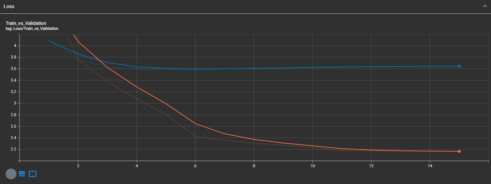
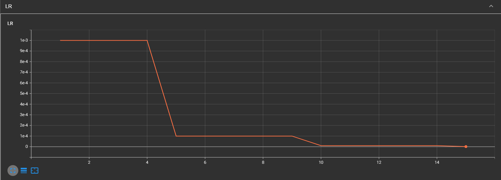

# TP5 : Image Captioning avec RNN et Attention sur ResNet

## Exercice 1 : Chargement des données et embeddings

### Question 1.a : Préparation du dataset Flickr30k

J'ai chargé Flickr30k dans `dataset.py`. Le jeu contient **31 783 images**, chacune associée à cinq descriptions. Je l'ai séparé aléatoirement, avec une graine fixée à 42, en **25 426 images d'entraînement (80 %)** et **6 357 images de test (20 %)**. J'ai utilisé des batches de 32 images, mélangés pour l'entraînement mais pas pour le test.

J'ai appliqué `Resize((224, 224))`, `ToTensor()` et la normalisation ImageNet (`mean=[0.485, 0.456, 0.406]`, `std=[0.229, 0.224, 0.225]`). Un batch vérifié a la forme `(32, 3, 224, 224)`.

**Pourquoi redimensionner les images à une taille fixe plutôt que conserver leur résolution d'origine ?**

Les images de Flickr30k n'ont pas toutes la même résolution. En les redimensionnant à **224 × 224**, je peux les regrouper dans un même tenseur et les transmettre à ResNet50, pré-entraîné avec ce format d'entrée. Cela évite des dimensions variables d'un batch à l'autre et permet de mieux contrôler la mémoire GPU et le temps de calcul. En contrepartie, le redimensionnement peut déformer légèrement certaines images.

### Question 1.b : Embeddings Word2Vec

Dans `text_utils.py`, j'ai construit un vocabulaire à partir des descriptions, puis chargé les vecteurs Word2Vec pré-entraînés sur GoogleNews. J'ai obtenu **20 324 mots distincts**, auxquels j'ai ajouté les tokens spéciaux `<PAD>` et `<UNK>`, soit **20 326 entrées** dans la matrice d'embeddings.

Parmi les 20 324 mots, **17 377** possèdent une correspondance dans Word2Vec, ce qui représente une couverture de **85,50 %**. Les **2 947 mots restants** conservent des vecteurs initialisés aléatoirement. La matrice obtenue a la forme **`(20326, 300)`** et les embeddings sont gelés (`requires_grad=False`).

La fonction `tokenize` transforme chaque mot en indice, limite les descriptions à **20 positions** et complète les phrases courtes avec des zéros. J'ai vérifié cette étape avec « A man is walking » : le décodage restitue bien « a man is walking ». J'ai sauvegardé la matrice et les dictionnaires dans `checkpoints/text_data.pt`, pour conserver les mêmes indices pendant l'entraînement.

Ces embeddings donnent au LSTM une représentation vectorielle pré-entraînée des mots, plutôt que de partir uniquement d'indices sans information lexicale. Une limite de mon implémentation est que les mots absents de Word2Vec conservent leur représentation initiale, puisque la couche est gelée.

## Exercice 2 : Extraction de caractéristiques et transfer learning

### Question 2.a : ResNet50 pré-entraîné

Dans `model.py`, j'ai chargé ResNet50 avec ses poids ImageNet. J'ai retiré ses deux dernières couches, `AdaptiveAvgPool2d` et la couche de classification `Linear`, afin de conserver la carte spatiale utile à l'attention. J'ai ensuite gelé les paramètres de l'extracteur (`requires_grad=False`).

**Pourquoi est-il important de geler les poids ?**

- **Raison matérielle :** le gel évite de calculer et de conserver les gradients des paramètres de ResNet50. Il réduit donc les calculs et la mémoire nécessaires à l'entraînement.
- **Raison algorithmique :** ResNet50 possède déjà des caractéristiques visuelles apprises sur ImageNet. Les conserver permet d'entraîner surtout le décodeur textuel et l'attention, sans modifier inutilement cette représentation sur un dataset plus petit comme Flickr30k. Cela limite aussi le risque de sur-apprentissage du backbone.

**Quelle est la dimension de sortie pour une entrée `(32, 3, 224, 224)` ?**

La sortie est **`(32, 2048, 7, 7)`**. Elle contient donc, pour chacune des 32 images, **49 régions spatiales** décrites par **2 048 caractéristiques**. J'ai vérifié ce résultat dans le script : pour deux images, la sortie est `(2, 2048, 7, 7)` et le nombre de paramètres entraînables du CNN vaut zéro.

## Exercice 3 : Module d'attention et LSTM personnalisé

### Question 3.a : Attention spatiale

J'ai implémenté `AttentionModule` dans `model.py`. Il combine les caractéristiques de ResNet50 avec l'état caché courant du LSTM, calcule un score par région, applique `softmax` sur les **49 régions**, puis effectue une somme pondérée des caractéristiques visuelles.

**À quoi correspond le `context_vector` et quel problème du Seq2Seq classique résout-il ?**

Le `context_vector` résume les régions de l'image auxquelles le modèle accorde le plus d'importance à un pas de temps donné. Il évite de devoir utiliser le même vecteur visuel global pour prédire tous les mots, comme dans un Seq2Seq de base : le décodeur peut ainsi porter son attention sur des zones différentes de l'image au cours de la phrase.

Avec deux images, j'obtiens un vecteur de contexte de forme **`(2, 2048)`** et des poids d'attention de forme **`(2, 1, 7, 7)`**. J'ai également vérifié que la somme des 49 poids vaut **1 pour chaque image**, ce qui confirme la normalisation par `softmax`.

### Question 3.b : Implémentation du LSTM avec attention

J'ai écrit la cellule `LSTMWithAttention` manuellement, sans utiliser `nn.LSTM`, pour intégrer le contexte visuel à chaque pas de temps. Le LSTM reçoit l'embedding du mot courant (**300 valeurs**), l'état caché précédent (**512 valeurs**) et le vecteur de contexte (**2 048 valeurs**). Les quatre couches linéaires reçoivent donc une concaténation de **2 860 valeurs**.

À chaque pas de temps, je calcule la porte d'entrée `i_t` avec `sigmoid`, la porte d'oubli `f_t` avec `sigmoid`, la mémoire candidate `g_t` avec `tanh` et la porte de sortie `o_t` avec `sigmoid`. La mise à jour de la mémoire et de l'état caché suit :

```python
c_t = f_t * c_t + i_t * g_t
h_t = o_t * torch.tanh(c_t)
```

La porte d'oubli sélectionne la partie de la mémoire précédente que je conserve, la porte d'entrée contrôle l'ajout de nouvelles informations, et la porte de sortie détermine l'état caché transmis au pas suivant. Le vecteur de contexte est recalculé à chaque mot à partir de cet état caché.

Mon test avec **2 descriptions de 5 mots** donne une séquence cachée de taille **`(2, 5, 512)`**, un dernier état caché **`(2, 512)`** et un dernier état mémoire **`(2, 512)`**. Les dimensions correspondent à celles attendues.

## Exercice 4 : Modèle global et entraînement

### Question 4.a : Assemblage du modèle

J'ai combiné dans `ImageCaptioningModel` l'extracteur ResNet50 gelé, les embeddings Word2Vec, le LSTM personnalisé et son module d'attention. La dernière couche `Linear(512, 20326)` projette chaque état caché du LSTM vers un score pour chacun des tokens du vocabulaire.

Pour vérifier l'assemblage, j'ai envoyé deux images `(2, 3, 224, 224)` et deux séquences de cinq tokens `(2, 5)`. La sortie est **`(2, 5, 20326)`** : pour chaque position de chaque description, le réseau fournit bien un score par token possible. Ce test valide les dimensions, mais pas encore la qualité des légendes prédites.

### Question 4.b : Entraînement, générations et StepLR

J'ai lancé l'entraînement complet sur **Slurm**, avec le job **54390**, sur un GPU **NVIDIA L4**. Le modèle a effectué **15 époques** sur Flickr30k, avec un batch size de **32**, l'optimiseur **Adam** (`lr=0.001`), la fonction **`CrossEntropyLoss(ignore_index=0)`** et le scheduler **`StepLR(step_size=5, gamma=0.1)`**.

Pour entraîner la prédiction du mot suivant, je donne au modèle les descriptions sans leur dernière position (`captions[:, :-1]`) et je compare les sorties aux descriptions décalées d'une position (`captions[:, 1:]`). Le padding est ignoré dans la loss.

#### Évolution des pertes



| Époque | Train Loss | Validation Loss |
|---|---:|---:|
| 1 | 4.8507 | 4.0870 |
| 4 | 3.0762 | **3.5859** |
| 5 | 2.8057 | 3.5913 |
| 10 | 2.2306 | 3.6318 |
| 15 | **2.1609** | 3.6451 |

La Train Loss baisse régulièrement, de **4.8507** à **2.1609**. La Validation Loss atteint son minimum, **3.5859**, à l'époque **4**, puis remonte progressivement jusqu'à **3.6451** à l'époque 15. J'en conclus que le modèle commence à **sur-apprendre après l'époque 4** : il s'ajuste toujours mieux aux images d'entraînement, mais ses performances sur la validation ne s'améliorent plus. Le meilleur checkpoint est donc celui de l'époque 4, sauvegardé dans `checkpoints/best_captioning_20261105_095836.pth`.

#### Comparaison des descriptions aux époques 1 et 10

J'ai comparé les prédictions produites pour la même image de validation. La génération est **auto-régressive** : à chaque étape, le modèle réutilise le token qu'il vient de prédire, sans recevoir les mots de la description de référence.

**Description de référence :**

> A little girl has her arms around a little boy standing on a wooden bridge in the woods .

**Prédiction à l'époque 1 :**

> a little girl in a blue shirt and a blue shirt and a blue shirt and a blue shirt

**Prédiction à l'époque 10 :**

> two girls in a forest , one in a white shirt , one in a white shirt , one

À l'époque 1, la prédiction commence de façon pertinente avec « a little girl », mais la syntaxe devient répétitive : le modèle reproduit plusieurs fois « a blue shirt ». À l'époque 10, la description est plus variée et mentionne la forêt, ce qui se rapproche de « in the woods » dans la référence. En revanche, le modèle décrit deux filles au lieu d'une fille et d'un garçon, invente des détails vestimentaires et conserve une répétition. **La phrase s'améliore un peu sur la variété des mots, mais pas suffisamment sur la cohérence et la fidélité à l'image.**

À l'époque 15, la prédiction reste incomplète et comporte toujours des erreurs (« two girls in a white shirt and blue jeans ... »). Cela confirme qu'un entraînement plus long ne garantit pas ici de meilleures légendes.

#### Analyse du scheduler StepLR



Avec `StepLR(step_size=5, gamma=0.1)`, le learning rate est **divisé par 10 toutes les cinq époques** :

| Époques d'entraînement | Learning rate utilisé |
|---|---:|
| 1 à 5 | 0.001 |
| 6 à 10 | 0.0001 |
| 11 à 15 | 0.00001 |

Après l'époque 15, le scheduler passe à **0.000001**, mais cette nouvelle valeur n'est plus utilisée pour une autre époque. C'est pourquoi elle apparaît au dernier point de TensorBoard.

**Que se passerait-il si je gardais `lr=0.001` constant ?** Avec un pas de mise à jour plus grand jusqu'à la fin, le modèle risquerait de continuer à osciller autour d'une bonne solution, voire de la dépasser, plutôt que de stabiliser ses paramètres par des ajustements plus fins. Ce n'est pas certain qu'il divergerait, mais la convergence pourrait être moins stable.

**Pourquoi cette diminution est-elle pertinente avec Adam et les méthodes fondées sur le momentum ou RMSProp ?** Adam ajuste déjà les mises à jour à partir de moyennes mobiles des gradients et de leurs carrés. Toutefois, ces estimations ne rendent pas le learning rate global inutile. Lorsque les gradients deviennent faibles ou bruités en fin d'entraînement, diminuer ce taux réduit l'amplitude des mises à jour, même en présence de l'inertie liée au momentum. Cela aide à stabiliser l'optimisation autour d'un minimum.

Dans mon entraînement, le scheduler a bien fonctionné, mais **la réduction du learning rate n'a pas empêché le sur-apprentissage** observé après l'époque 4. La diminution de la Train Loss ne suffit donc pas à conclure que les légendes générées s'améliorent.

## Bilan

J'ai réalisé un modèle d'Image Captioning combinant ResNet50 pré-entraîné et gelé, Word2Vec, une attention spatiale et un LSTM écrit manuellement. Les tests de dimensions et l'entraînement complet ont fonctionné. Le modèle produit des descriptions qui contiennent certains éléments pertinents de l'image, mais aussi des répétitions et des erreurs.

Le meilleur résultat est obtenu à **l'époque 4**, avec une **Validation Loss de 3.5859**. Les courbes montrent ensuite un sur-apprentissage. Je retiens surtout que l'attention permet de réutiliser des régions visuelles différentes au cours de la phrase, mais que la qualité des légendes dépend aussi de la capacité du modèle à généraliser.
